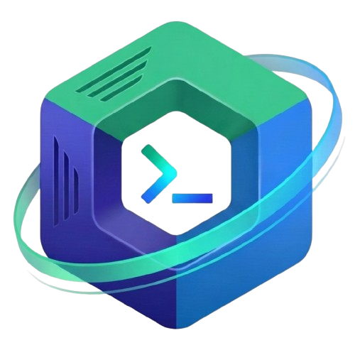

<div align="center">



# Fast Compose CLI

**Check and render Compose previews from the terminal and AI agents. No compiler, no build, no waiting.**

Runs Jetpack Compose and Compose Multiplatform `@Preview` functions in seconds, in a terminal, in CI, or as an MCP
server for AI agents, powered by [Fast Compose](https://github.com/fast-compose/fast-compose).

[](https://github.com/fast-compose/compose-cli/releases)
[](https://central.sonatype.com/namespace/io.github.fast-compose)
[](LICENSE)


</div>

---

```bash
fast-compose render app/src/main/kotlin/app/ui/HomeScreen.kt -o previews
```

```
app/src/main/kotlin/app/ui/HomeScreen.kt
  preview  Light (HomePreview)  line 42  →  previews/HomeScreen-Light.png (822 × 1782 px)
  preview  Dark (HomePreview)  line 43  ·  dark  →  previews/HomeScreen-Dark.png (822 × 1782 px)
1 file(s), 0 error(s), 0 warning(s)
```

## Features

- **Check** previews for parse errors, unknown names, wrong arguments and runtime errors, with file, line and preview.
- **Render** every `@Preview` to a PNG at its size, theme, font scale and locale, or at a device size.
- **List** the previews of files and folders with their `@Preview` settings.
- **MCP server** with the tools `check`, `render` and `list_previews`, so agents can check the Compose code they write
  and see it, even before saving it.
- **Projects without a build:** composables, themes and models from other files, `R` and `Res` resources, and real
  library code from jars.
- **Every preview Android Studio shows**, including multi-preview annotations such as `@PreviewLightDark` and one
  preview per `@PreviewParameter` value.
- **Text or JSON** output, exit codes for CI, a quiet mode, and a progress bar for long runs.
- **One download**, with its own trimmed Java runtime: nothing else to install.

## Install

Download the zip for your system from the [releases](https://github.com/fast-compose/compose-cli/releases):

| System | Zip |
|---|---|
| Windows | `fast-compose-<version>-windows-x64.zip`, `-windows-arm64.zip` |
| macOS | `fast-compose-<version>-macos-arm64.zip` (Apple silicon), `-macos-x64.zip` (Intel) |
| Linux | `fast-compose-<version>-linux-x64.zip`, `-linux-arm64.zip` |

Unzip it and add its `bin` folder to your `PATH`, then check it works:

```bash
fast-compose version
```

On macOS, if the system blocks the downloaded runtime, remove the quarantine flag from the unzipped folder:
`xattr -dr com.apple.quarantine fast-compose-<version>`.

## Usage

```bash
# Check a file, a folder, or a whole source tree
fast-compose check HomeScreen.kt
fast-compose check -r app/src

# Multi-module projects: read every module's sources and resources
fast-compose render -r . --modules -o previews

# Render previews to PNGs
fast-compose render ui -o previews
fast-compose render "app/src/**/*Screen.kt" --dark --size tablet -o previews

# List previews as JSON
fast-compose list -r app/src --json

# Errors only, e.g. in CI
fast-compose check -r app/src --ignore-warnings
```

| Command | What it does |
|---|---|
| `check [paths]` | Runs previews off-screen and reports problems |
| `render [paths]` | Renders each preview to a PNG |
| `list [paths]` | Lists previews and their settings, without running them |
| `mcp` | Runs the MCP server |
| `version`, `help` | Prints the version, or the commands and options |

Paths are files, folders or globs; without one, the current folder is used. Subfolders are searched with `-r`. Errors
give exit code 1. See [Commands and options](docs/COMMANDS.md) for everything else.

## MCP server

```bash
claude mcp add --scope user fast-compose -- fast-compose mcp
```

On Windows:

```bash
claude mcp add --scope user fast-compose -- cmd /c fast-compose mcp
```

Or in any MCP client's configuration:

```json
{
  "mcpServers": {
    "fast-compose": { "command": "fast-compose", "args": ["mcp"] }
  }
}
```

| Tool | Returns |
|---|---|
| `check` | Problems as JSON, for a file, folder or unsaved `code` |
| `render` | A PNG image per preview, and problems |
| `list_previews` | Previews with their names, lines and settings |

See [MCP server](docs/MCP.md) for Claude Desktop, Cursor and VS Code, Windows setup and every argument.

## How it works

The [Fast Compose](https://github.com/fast-compose/fast-compose) engine parses Kotlin and runs it with an
interpreter that calls the real Compose APIs, so previews need no Kotlin compiler, Compose compiler plugin or Gradle
build. Fast Compose CLI draws them off-screen with Compose Desktop, the way an IDE preview would, and finds the files,
resources and libraries a preview uses from the project's folder layout.

A preview that renders here may still fail to compile: the code is interpreted, not type-checked. Build before
shipping.

## Documentation

| Guide | What it covers |
|---|---|
| [Commands and options](docs/COMMANDS.md) | Every command and option, paths and globs, rendering, exit codes, recipes |
| [Output](docs/OUTPUT.md) | The text and JSON reports, field by field, with `jq` and PowerShell examples |
| [Projects](docs/PROJECTS.md) | Other files, resources and library code; the classpath Gradle task; `@Preview` support |
| [MCP server](docs/MCP.md) | Client setup, tools and arguments, results, errors, protocol |
| [Building and releasing](docs/BUILDING.md) | Project layout, Gradle tasks, targets, the bundled runtime, CI and releases |

## Troubleshooting

| Message | What to do |
|---|---|
| `'X' (some.library) has no binding; a stand-in is used` | The library call ran as a placeholder. Pass the library's jars with `--classpath` ([Projects](docs/PROJECTS.md#library-code)) |
| `Unresolved reference 'X' (imported from app.ui)` | No file declares it under the searched roots; add `--modules` to read every module |
| `'Instant' (kotlinx.datetime) has no binding` | The project uses kotlinx-datetime 0.6, the CLI ships 0.7; pass the project's own jar with `--classpath` ([Projects](docs/PROJECTS.md#library-code)) |
| `UnsupportedClassVersionError … class file version 65.0` | The installation has no `runtime/` and the Java in `JAVA_HOME` is older than 21 |
| `Timed out loading the files the preview uses` | Loading took over 20 seconds; check the other files the preview reaches |
| `Preview crashed: …` | Compose threw while drawing; the message names the exception |
| `The language tag und is not well-formed …` | A harmless engine message on stderr; `--quiet` or `2>nul` hides it |

Engine issues, such as an unsupported API, go to the
[Fast Compose issues](https://github.com/fast-compose/fast-compose/issues); CLI issues to
[this repository's](https://github.com/fast-compose/compose-cli/issues).

## License

[Apache 2.0](LICENSE)
